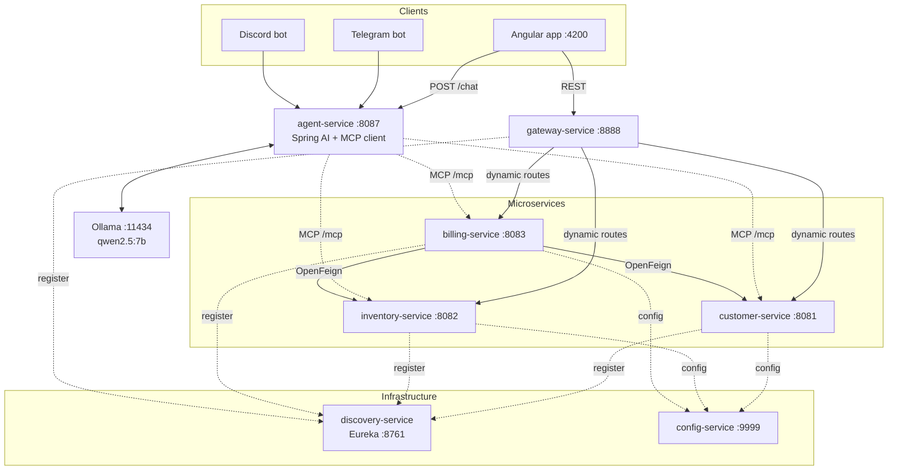

# E-commerce Microservices with an Agentic AI Assistant


A microservice application that manages **customers**, **products** and **bills**, turned into an **agentic system**: an AI assistant talks to the microservices through the **Model Context Protocol (MCP)** and answers questions in natural language from a **web app**, **Telegram** or **Discord**.

> *"What are Imane's bills?"* → the agent looks the customer up, fetches her bills and replies with the products and totals in MAD, all from live data.

## Table of contents

- [Architecture](#architecture)
- [Services](#services)
- [The AI agent](#the-ai-agent)
- [Getting started](#getting-started)
- [Chat clients](#chat-clients)
- [Screenshots](#screenshots)
- [Project structure](#project-structure)
- [Troubleshooting](#troubleshooting)

## Architecture



Two paths coexist:

- **Classic path**: the Angular pages read the REST APIs through the gateway, which builds its routes dynamically from Eureka (`/CUSTOMER-SERVICE/api/customers`, …).
- **Agentic path**: the web chat, Telegram and Discord talk to `agent-service`. The LLM decides which MCP tools to call, the agent calls them on the microservices, and the LLM writes the answer.

## Services

| Service | Port | Role |
|---|---|---|
| `config-service` | 9999 | Spring Cloud Config Server, configuration stored in Git |
| `discovery-service` | 8761 | Eureka service registry |
| `customer-service` | 8081 | Customers (Spring Data REST on `/api`) + MCP server |
| `inventory-service` | 8082 | Products and stock + MCP server |
| `billing-service` | 8083 | Bills, enriched with customer and product data via OpenFeign + MCP server |
| `gateway-service` | 8888 | Spring Cloud Gateway, dynamic routing through Eureka, CORS for Angular |
| `agent-service` | 8087 | AI agent: Ollama LLM, MCP client, chat memory, REST API, Telegram and Discord bots |
| `ecom-web` | 4200 | Angular client: customers, products, bills, AI assistant |

## The AI agent

### MCP tools

Each business service exposes its tools with `@McpTool` on `http://localhost:<port>/mcp` (Streamable HTTP transport).

| Service | Tools |
|---|---|
| customer-service | `getAllCustomers`, `getCustomerById`, `searchCustomersByName`, `createCustomer` |
| inventory-service | `getAllProducts`, `getProductById`, `searchProductsByName`, `getLowStockProducts` |
| billing-service | `getAllBills`, `getBillById`, `getBillsByCustomerId`, `getBillTotal` |

```java
@McpTool(name = "getBillsByCustomerId",
        description = "Returns only the bills of the given customer (amounts in MAD)")
public List<BillView> getBillsByCustomerId(@McpToolParam(description = "Customer id") Long customerId) {
    return billService.getFullBillsByCustomer(customerId).stream().map(BillView::of).toList();
}
```

Billing tools return a `BillView` with **line totals and the bill total already computed server-side**: small local models are unreliable at arithmetic, so the agent never has to calculate.

### Agent

```java
this.chatClient = chatClientBuilder
        .defaultSystem(SYSTEM_PROMPT)                                          // rules: use tools, MAD, no recalculation
        .defaultAdvisors(MessageChatMemoryAdvisor.builder(chatMemory).build()) // memory per conversation
        .defaultTools(mcpTools)                                                // the 12 MCP tools
        .build();
```

The MCP connections are plain configuration:

```properties
spring.ai.mcp.client.streamable-http.connections.customer-service.url=http://localhost:8081
spring.ai.mcp.client.streamable-http.connections.inventory-service.url=http://localhost:8082
spring.ai.mcp.client.streamable-http.connections.billing-service.url=http://localhost:8083
```

Every conversation keeps its own memory: one per browser tab, per Telegram chat and per Discord channel.

## Getting started

### Prerequisites

- **JDK 21** (Spring AI 2.0 requires it)
- **Maven 3.9+** (or the bundled `mvnw`)
- **Node.js 20+** for the Angular client
- **[Ollama](https://ollama.com/download)** with a model that supports tool calling:

```bash
ollama pull qwen2.5:7b
```

### Run the backend

Start the services **in this order**. The agent must come last because it connects to the three MCP servers at startup.

```bash
# 1. infrastructure
cd config-service    && mvn spring-boot:run
cd discovery-service && mvn spring-boot:run
# 2. business services
cd customer-service  && mvn spring-boot:run
cd inventory-service && mvn spring-boot:run
cd billing-service   && mvn spring-boot:run
# 3. entry points
cd gateway-service   && mvn spring-boot:run
cd agent-service     && mvn spring-boot:run
```

Quick checks:

| URL | Expected |
|---|---|
| http://localhost:8761 | Eureka lists the services |
| http://localhost:8888/CUSTOMER-SERVICE/api/customers | Customers through the gateway |
| http://localhost:8081/mcp | `Invalid Accept header`: the MCP endpoint is up (browsers can't speak MCP) |
| http://localhost:8087/chat?query=What%20are%20the%20customers%3F | An answer listing the customers |

### Run the Angular client

```bash
cd ecom-web
npm install
npm start          # http://localhost:4200
```

Backend URLs are set in `ecom-web/src/app/config.ts`.

## Chat clients

Both bots run inside `agent-service` and only start when their token is set. Pass the tokens as **environment variables**, never commit them:

```bash
TELEGRAM_BOT_TOKEN=123456789:AAH...
DISCORD_BOT_TOKEN=MTE...
```

In IntelliJ: *Run → Edit Configurations → AgentServiceApplication → Environment variables* (not *Active profiles*).

**Telegram**
1. Talk to [@BotFather](https://t.me/BotFather), send `/newbot` and copy the token.
2. Open your bot and send `/start`, then ask a question.

**Discord**
1. Create an application on the [Discord Developer Portal](https://discord.com/developers/applications), then copy the token in the **Bot** tab.
2. Enable **MESSAGE CONTENT INTENT** in the same tab and click **Save Changes**. Without it, Discord rejects the connection with code `4014`.
3. Invite the bot with *OAuth2 → URL Generator*: scope `bot`, permissions *Send Messages* and *Read Message History*.
4. Talk to it by direct message, by mentioning it (`@bot what are the customers?`) or with the `!ask` prefix.

### Example questions

- *What are the customers?*
- *Which products have fewer than 10 units in stock?*
- *What are Imane's bills?* (chains `searchCustomersByName` → `getBillsByCustomerId`)
- *What is the total of bill 1?*
- *Add a customer named Sara with the email sara@gmail.com*

## Screenshots

| AI assistant (Angular) | Customers |
|---|---|
|  |  |

| Products | Agent called over HTTP |
|---|---|
|  |  |

<!-- Add your own: docs/screenshots/telegram.png, docs/screenshots/discord.png, docs/screenshots/eureka.png -->

## Project structure

```
ecom-ms-app/
├── config-service/       Spring Cloud Config Server
├── config-repo/          configuration files (*.properties)
├── discovery-service/    Eureka registry
├── gateway-service/      Spring Cloud Gateway
├── customer-service/     customers + MCP tools (mcp/CustomerMcpTools.java)
├── inventory-service/    products + MCP tools (mcp/InventoryMcpTools.java)
├── billing-service/      bills, OpenFeign clients + MCP tools (mcp/BillingMcpTools.java)
├── agent-service/        AI agent (agent/AiAgent.java), REST API, telegram/, discord/
├── ecom-web/             Angular client
└── pom.xml               parent POM listing the Maven modules
```

## Troubleshooting

| Symptom | Fix |
|---|---|
| `invalid target release: 21` | Switch the project SDK to JDK 21 |
| `agent-service` fails to start with an MCP connection error | Start customer, inventory and billing first |
| The agent answers without calling tools or makes things up | Use a tool-calling model (`qwen2.5`, `qwen3`, `llama3.1`) |
| `Connection refused localhost:11434` | Start Ollama (`ollama serve`) |
| Discord `CloseCode 4014 DISALLOWED_INTENTS` | Enable MESSAGE CONTENT INTENT in the Developer Portal and save |
| Bills show the customer `default` | Feign paths must include the Spring Data REST base path: `/api/customers/{id}` |


